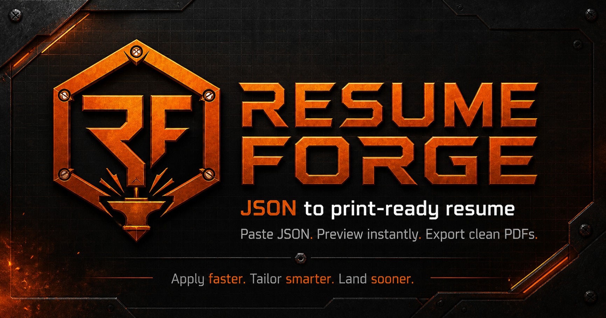

# Resume Forge

Resume Forge is a JSON-powered resume builder designed for faster, AI-assisted job applications.

Many job seekers already use AI tools like ChatGPT, Gemini, or Claude to rewrite and tailor resumes for different roles. The problem is that AI-generated resume content still needs to be manually copied into a document, reformatted, adjusted, and exported before it can be submitted.

Resume Forge removes that extra formatting step.

Instead of manually rebuilding a resume layout every time, you can ask an AI assistant to generate resume data in the Resume Forge JSON schema, paste it into the app, preview the formatted resume instantly, and export a clean PDF-ready page.

**Copy. Paste. Parse. Export. Apply.**



## Why I Built It

Tailoring resumes is one of the most repetitive parts of job hunting.

For every job application, candidates often need to adjust their summary, skills, experience bullets, and project descriptions. AI can help rewrite the content, but the workflow usually breaks down after that:

- AI generates improved resume content
- The user manually copies sections into a resume document
- Formatting breaks
- Spacing needs to be fixed
- Layout has to be adjusted
- The final resume still needs to be exported as a PDF

That process is slow and repetitive.

Resume Forge is built to make this workflow more efficient by separating **resume content** from **resume layout**. AI can generate the structured content, while Resume Forge handles rendering, preview, template selection, and export.

The goal is simple:

**Apply faster. Tailor smarter. Land sooner.**

## What Resume Forge Does

Resume Forge turns structured JSON resume data into a clean, ATS-friendly, print-ready resume.

You can:

- Paste resume JSON directly into the editor
- Use AI-generated JSON from ChatGPT, Gemini, Claude, or other AI tools
- Parse the JSON into a live resume preview
- Switch between resume templates
- Export the result through a browser print / Save as PDF workflow
- Keep resume formatting consistent without manually editing layouts

## Key Features

- **AI-friendly workflow**  
  Designed for users who want AI to generate structured resume content instead of manually editing a document.

- **JSON-first resume editing**  
  Resume content is stored as structured JSON, making it easy to generate, edit, validate, and reuse.

- **ATS-friendly output**  
  Templates are designed to stay clean, readable, and suitable for applicant tracking systems.

- **Live preview**  
  Parse JSON and immediately preview the rendered resume.

- **Multiple templates**  
  Use the same resume data with different visual templates.

- **Mock data loader**  
  Quickly test the product with sample resume data.

- **Print-ready export page**  
  Open a clean export page and use browser print or Save as PDF.

- **Typed resume schema**  
  Built with TypeScript types for predictable rendering and safer data handling.

## Product Flow

1. Open Resume Forge
2. Paste or edit your resume JSON
3. Choose a resume template
4. Click `Parse JSON`
5. Review the live preview
6. Click `Export PDF`
7. Use browser print or Save as PDF
8. Submit your resume

## AI-Assisted Workflow

A typical workflow looks like this:

1. Copy the Resume Forge JSON schema
2. Paste your existing resume or career details into an AI assistant
3. Ask the AI assistant to generate a resume using the Resume Forge JSON format
4. Copy the generated JSON
5. Paste it into Resume Forge
6. Parse, preview, and export

Example prompt:

```text
Convert my resume into the following JSON schema for Resume Forge.

{
  "basicInfo": {
    "name": "",
    "contact": {
      "tel": "",
      "email": "",
      "location": "",
      "extra": {
        "status": {
          "content": ""
        },
        "linkedIn": {
          "content": "",
          "link": ""
        },
        "github": {
          "content": "",
          "link": ""
        },
        "portfolio": {
          "content": "",
          "link": ""
        },
        "website": {
          "content": "",
          "link": ""
        }
      }
    }
  },
  "summary": "",
  "skills": {
    "Languages": [],
    "Frontend": [],
    "Backend": [],
    "Databases": [],
    "CloudDevOps": [],
    "Tools": []
  },
  "experiences": [
    {
      "company": "",
      "title": "",
      "location": "",
      "date": "",
      "description": []
    }
  ],
  "projects": [
    {
      "name": "",
      "tools": [],
      "date": "",
      "url": "",
      "description": []
    }
  ],
  "education": [
    {
      "school": "",
      "degree": "",
      "major": "",
      "location": "",
      "date": "",
      "startDate": "",
      "endDate": "",
      "gpa": "",
      "honors": [],
      "description": []
    }
  ],
  "certifications": [
    {
      "name": "",
      "issuer": "",
      "date": "",
      "expirationDate": "",
      "credentialId": "",
      "url": ""
    }
  ]
}

Return only valid JSON.
````

This allows AI to handle the content generation while Resume Forge handles the layout and export.

## Resume Schema

Resume Forge currently supports the following top-level sections:

* `basicInfo`
* `summary`
* `skills`
* `experiences`
* `projects`
* `education`
* `certifications`

Example shape:

```json
{
  "basicInfo": {
    "name": "Alex Morgan",
    "contact": {
      "tel": "+1 (555) 876-5432",
      "email": "alex.morgan@example.com",
      "location": "Austin, TX",
      "extra": {
        "linkedIn": {
          "content": "linkedin.com/in/alexmorgan",
          "link": "https://linkedin.com/in/alexmorgan"
        },
        "github": {
          "content": "github.com/alexmorgan",
          "link": "https://github.com/alexmorgan"
        },
        "portfolio": {
          "content": "alexmorgan.dev",
          "link": "https://alexmorgan.dev"
        },
        "website": {
          "content": "alexmorgan.dev/blog",
          "link": "https://alexmorgan.dev/blog"
        },
        "status": {
          "content": "U.S. Citizen | Authorized to work in the U.S. | Open to Relocation"
        }
      }
    }
  },
  "summary": "Full Stack Engineer with 5+ years of experience building scalable web applications and leading feature development. Proficient in modern JavaScript frameworks, cloud-native architectures, and DevOps practices. Passionate about clean code, system design, and mentoring junior engineers. Recently focused on AI-integrated tools and real-time data processing.",
  "skills": {
    "Languages": ["TypeScript", "JavaScript (ES2022+)", "Python", "Go", "Java", "SQL", "HTML5/CSS3"],
    "Frontend": ["React 18", "Next.js 14", "Vue 3", "Tailwind CSS", "Redux Toolkit", "TanStack Query", "Vite", "Framer Motion"],
    "Backend": ["Node.js (Express/NestJS)", "Python (FastAPI/Django)", "Go (Gin/Fiber)", "GraphQL (Apollo)", "RESTful APIs", "gRPC", "WebSockets"],
    "Databases": ["PostgreSQL", "MongoDB", "Redis", "DynamoDB", "Prisma ORM", "TypeORM", "MySQL"],
    "CloudDevOps": ["AWS (EC2, Lambda, S3, RDS, API Gateway, ECS)", "Docker", "Kubernetes (EKS)", "Terraform", "GitHub Actions", "CI/CD pipelines", "Prometheus/Grafana"],
    "Tools": ["Git/GitHub", "VS Code", "Postman", "Swagger", "Jest", "Cypress", "Storybook", "Figma", "Slack/Teams", "Jira"]
  },
  "experiences": [
    {
      "company": "TechFlow Solutions",
      "title": "Senior Full Stack Engineer",
      "location": "Austin, TX (Hybrid)",
      "date": "Jan 2023 – Present",
      "description": [
        "Led migration of monolithic React app to Next.js 14 + App Router, improving initial load time by 42% and SEO scores from 62 to 98.",
        "Architected and deployed serverless backend using AWS Lambda, API Gateway, and DynamoDB, reducing infrastructure costs by 35%.",
        "Implemented real-time dashboard with WebSockets and Redis pub/sub, supporting 5k+ concurrent users for live analytics.",
        "Mentored 3 junior engineers, conducted code reviews, and established frontend best practices (testing, a11y, performance).",
        "Integrated OpenAI API for automated code documentation generation, saving team ~8 hours/week of manual writing."
      ]
    },
    {
      "company": "Nexify Labs",
      "title": "Full Stack Developer",
      "location": "San Francisco, CA (Remote)",
      "date": "Aug 2020 – Dec 2022",
      "description": [
        "Built B2B SaaS product from scratch using React, Node.js, and PostgreSQL, achieving $2M ARR within 18 months.",
        "Designed and implemented GraphQL federation gateway (Apollo) to unify 3 microservices, reducing frontend data fetching complexity.",
        "Set up CI/CD pipelines with GitHub Actions and Docker Compose, decreasing deployment failures by 60%.",
        "Developed comprehensive unit and integration tests (Jest + Supertest) achieving 89% code coverage.",
        "Collaborated with product designers to build component library in Storybook, reused across 4 internal projects."
      ]
    },
    {
      "company": "CodeCanvas",
      "title": "Software Engineer (Intern → Junior)",
      "location": "Seattle, WA",
      "date": "Jun 2019 – Jul 2020",
      "description": [
        "Created RESTful APIs with Django REST Framework for mobile learning platform, serving 50k+ monthly active users.",
        "Optimized database queries (PostgreSQL) reducing average response time from 340ms to 85ms.",
        "Developed interactive frontend components using Vue 2 and Vuex, improving user engagement by 25%.",
        "Participated in agile ceremonies and bug-bashing sessions, fixing 100+ issues tracked in Jira."
      ]
    }
  ],
  "projects": [
    {
      "name": "AI Meeting Assistant (MeeGo)",
      "tools": ["Next.js 14", "TypeScript", "FastAPI", "WebSockets", "PostgreSQL", "Redis", "OpenAI Whisper", "Docker", "AWS ECS"],
      "date": "Jan 2024 – Present",
      "url": "github.com/alexmorgan/meego",
      "description": [
        "Real-time meeting transcription and summarization tool with speaker diarization and action item extraction.",
        "Streams audio via WebSockets to FastAPI backend, processes with Whisper + GPT-4, stores summaries in PostgreSQL with vector embeddings (pgvector).",
        "Deployed on AWS ECS with auto-scaling, supports 50 concurrent meetings; used by 200+ beta users."
      ]
    },
    {
      "name": "DevOps Dashboard (KubeView)",
      "tools": ["React", "Go", "Kubernetes", "Prometheus", "Grafana", "Redis", "Terraform"],
      "date": "Mar 2023 – Sep 2023",
      "url": "github.com/alexmorgan/kubeview",
      "description": [
        "Kubernetes cluster monitoring dashboard with real-time resource usage, pod logs, and cost breakdown per namespace.",
        "Backend service written in Go using client-go for K8s API, caching metrics in Redis; frontend with React + Recharts.",
        "Reduced on-call debugging time from 20min to <5min; adopted by 3 internal teams at TechFlow."
      ]
    },
    {
      "name": "Open Source Contributor – TanStack Query",
      "tools": ["TypeScript", "React", "Vitest"],
      "date": "Jan 2023 – ongoing",
      "url": "github.com/TanStack/query/pulls?author=alexmorgan",
      "description": [
        "Fixed 4 bugs and added optimistic update examples in documentation; currently reviewing PRs for v5 migration.",
        "Contributed to custom query client integration with local storage persister – merged in v4.29."
      ]
    }
  ],
  "education": [
    {
      "school": "University of Washington",
      "degree": "Bachelor of Science",
      "major": "Computer Science & Engineering",
      "location": "Seattle, WA",
      "date": "Class of 2019",
      "startDate": "Sep 2015",
      "endDate": "Jun 2019",
      "gpa": "3.8",
      "honors": ["Dean's List (2017-2019)", "ACM Student Research Competition – 2nd Place"],
      "description": [
        "Relevant coursework: Data Structures, Algorithms, Distributed Systems, Database Management, Web Development, Machine Learning.",
        "Capstone Project: Real-time bus tracking system for Seattle Metro using MQTT and React Native – awarded 'Best Applied Project'."
      ]
    }
  ],
  "certifications": [
    {
      "name": "AWS Certified Solutions Architect – Associate",
      "issuer": "Amazon Web Services",
      "date": "Nov 2023",
      "expirationDate": "Nov 2026",
      "credentialId": "AWS-SAA-8H7G3F2D",
      "url": "aws.amazon.com/verification"
    },
    {
      "name": "Kubernetes Application Developer (CKAD)",
      "issuer": "Linux Foundation / CNCF",
      "date": "Mar 2024",
      "expirationDate": "Mar 2027",
      "credentialId": "LF-ckad-2m9k4r",
      "url": "cncf.io/ckad/verify"
    },
    {
      "name": "Professional Full Stack Developer (Meta Certified)",
      "issuer": "Meta / Coursera",
      "date": "Jan 2023",
      "expirationDate": "",
      "credentialId": "META-FS-82j9a",
      "url": "coursera.org/verify/professional-cert/meta-full-stack"
    }
  ]
}
```

## Tech Stack

* Next.js 16
* React 19
* TypeScript
* Tailwind CSS 4
* `react-icons`

## Local Development

Install dependencies:

```bash
npm install
```

Start the development server:

```bash
npm run dev
```

Run checks:

```bash
npm run lint
npx tsc --noEmit
```

Build for production:

```bash
npm run build
```

## Current Focus

* Add more ATS-friendly resume templates
* Improve mobile responsiveness across the dashboard and export page
* Improve JSON validation and error messaging
* Add clearer schema examples for AI-assisted resume generation
* Improve production SEO metadata and Open Graph previews
* Polish print and PDF export behavior

## Roadmap Ideas

* Template categories by role type
* One-click copy of the default JSON schema
* JSON validation hints
* Import from existing resume text
* AI prompt templates
* Better print margin controls
* More export presets such as Letter and A4

## Author

**Zexiang Zhang**

* GitHub: [https://github.com/626-Legendary](https://github.com/626-Legendary)
* Email: [zhangzexiang626@gmail.com](mailto:zhangzexiang626@gmail.com)

## License

This project is licensed under the MIT License. See the [LICENSE](./LICENSE) file for details.